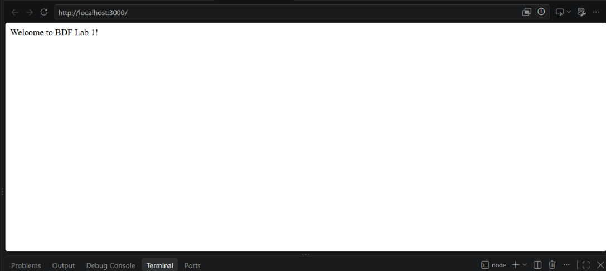
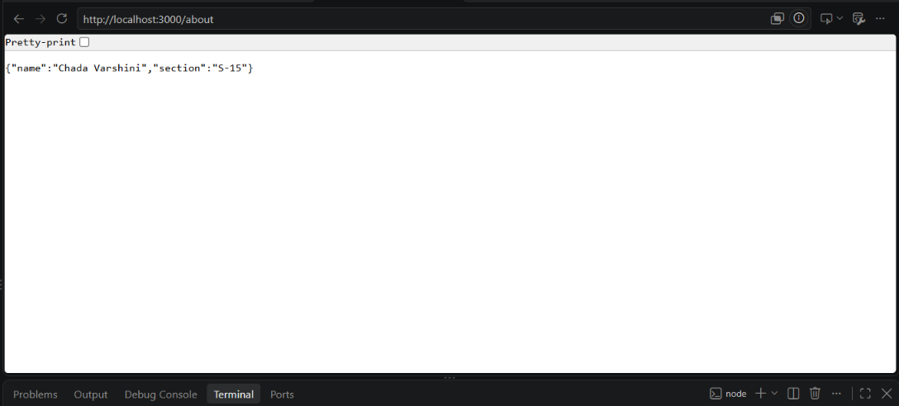
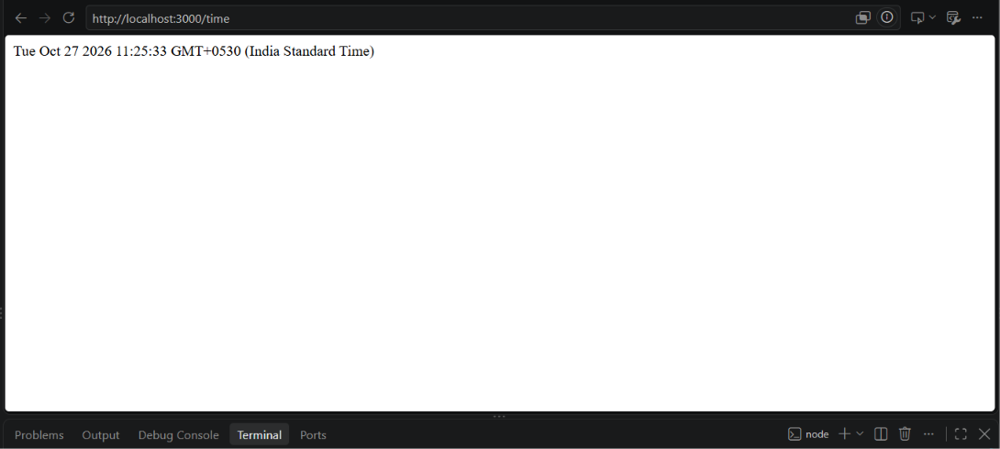
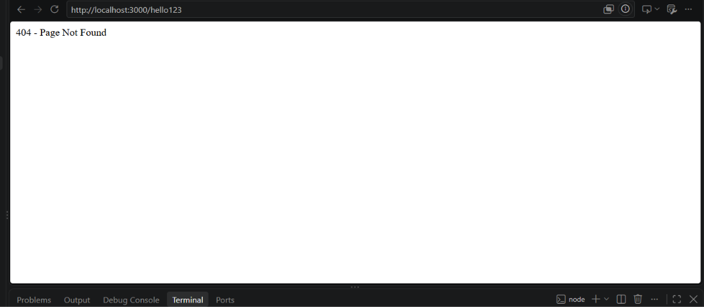

# BDF Lab 01 – Node.js and Express Server

**Deployment URL:** https://chada-varshini.onrender.com/

**Student Name:** Chada Varshini  
**Registration Number:** 252U1R1050  
**Section:** CSE - CORE (223 & S15)  
**Course:** Backend Development Fundamentals  
**Lab:** Lab 01 – Node.js and Express Server  

**GitHub Repository:** https://github.com/varshinichada2007-coder/Chada-Varshini

## 1. Introduction

This project is developed as part of the Backend Development Fundamentals course. It demonstrates how to create a basic HTTP server using Node.js and how to build a server with multiple API endpoints using Express.js.

The project includes a basic HTTP server, three Express GET routes, and a custom 404 response for unknown URLs.

## 2. Objectives

- Initialize a Node.js project using npm.
- Understand the purpose of `package.json`.
- Install Express.js.
- Create an HTTP server using Node.js.
- Build API routes using Express.js.
- Return text, JSON, and dynamic date/time responses.
- Handle invalid routes using HTTP status code 404.

## 3. Technologies Used

- Node.js
- Express.js
- JavaScript
- npm
- Visual Studio Code
- Web Browser
- Render

## 4. Project Structure

```text
Chada-Varshini/
├── .gitignore
├── http-server.js
├── server.js
├── package.json
├── package-lock.json
├── README.md
└── Screenshots/
    ├── home.png
    ├── about.png
    ├── time.png
    └── not-found.png
```

**Note:** The `node_modules` folder is excluded from GitHub using `.gitignore`. It can be created by running `npm install`.

## 5. Installation

### Step 1: Clone the repository

```bash
git clone https://github.com/varshinichada2007-coder/Chada-Varshini.git
```

### Step 2: Open the project folder

```bash
cd Chada-Varshini
```

### Step 3: Install dependencies

```bash
npm install
```

## 6. Execution

### Run the Node.js HTTP Server

```bash
node http-server.js
```

Open the following URL in a browser:

`http://localhost:3000`

**Expected Output:**

```text
Hello
```

Stop the server using `Ctrl + C` before starting the Express server.

### Run the Express Server

```bash
node server.js
```

The Express application runs locally at:

`http://localhost:3000`

## 7. API Endpoints

| Method | Endpoint | Description | Status Code |
|---|---|---|---|
| GET | `/` | Displays a welcome message | 200 |
| GET | `/about` | Returns student details in JSON format | 200 |
| GET | `/time` | Returns the current date and time | 200 |
| GET | `/hello123` | Returns a page-not-found message | 404 |

## 8. Screenshots

The following screenshots show the output of the endpoints tested using a web browser.

### Home Endpoint – GET /



### About Endpoint – GET /about



### Time Endpoint – GET /time



### Unknown Route – 404



## 9. Testing

The application was tested locally using a web browser.

- The home route displayed a welcome message.
- The about route displayed student details in JSON format.
- The time route displayed the current date and time.
- An unknown route displayed a page-not-found message.

Screenshots of these browser outputs are included in the `Screenshots/` folder.

## 10. Problems Faced and Solutions

**Problem 1:** Both the Node.js HTTP server and Express server use port 3000.

**Solution:** Stopped the running server using `Ctrl + C` before starting the next server.

**Problem 2:** Express requires dependencies to be installed.

**Solution:** Installed the required dependencies using `npm install`.

**Problem 3:** Unknown URLs should return an appropriate error response.

**Solution:** Added a 404 handler in the Express application to handle unknown routes.

## 11. Notes

- The application was developed using Node.js and Visual Studio Code.
- The application runs locally on port 3000.
- The project deployment URL is provided at the top of this README.
- No environment variables are required for local execution.
- The `node_modules` directory and `.env` files should not be uploaded to GitHub.
- Browser screenshots of the four endpoints are included in the `Screenshots/` folder.

## 12. Conclusion

This lab helped me understand how Node.js servers work and how Express.js simplifies backend development. I created a basic HTTP server and implemented Express routes for text responses, JSON data, current date/time, and 404 error handling. This project improved my understanding of backend development and API routing.
